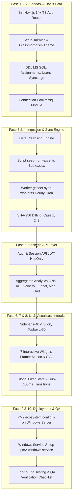

# RENCANA KERJA & IMPLEMENTASI (TASK.MD): TELECOM PRODUCTIVITY DASHBOARD

> **Status Proyek:** Blueprint to Implementation  
> **Target Arsitektur:** Decoupled High-Performance Web Application (Next.js App Router + MS SQL Server + GSheets Worker + PM2 Windows Server)  
> **Referensi Utama:** [`design.md`](file:///e:/DNational/design.md), [`list.md`](file:///e:/DNational/list.md), [`memory.md`](file:///e:/DNational/memory.md), dan [`Book1.xlsx`](file:///e:/DNational/Book1.xlsx) (10.236 baris data operasional).

---

## DAFTAR ISI
1. [Ringkasan Eksekutif & Pemahaman Spesifikasi](#ringkasan-eksekutif--pemahaman-spesifikasi)
2. [Matriks Pemetaan Kolom Data (Book1.xlsx vs Database Schema)](#matriks-pemetaan-kolom-data-book1xlsx-vs-database-schema)
3. [Roadmap & Fase Pengerjaan End-to-End](#roadmap--fase-pengerjaan-end-to-end)
   - [FASE 1: Inisialisasi Proyek, Konfigurasi Environment & Arsitektur Direktori](#fase-1-inisialisasi-proyek-konfigurasi-environment--arsitektur-direktori)
   - [FASE 2: Desain Basis Data MS SQL Server & Skrip Migrasi (DDL)](#fase-2-desain-basis-data-ms-sql-server--skrip-migrasi-ddl)
   - [FASE 3: Engine Data Cleansing & Modul Seeding Awal dari Excel (Book1.xlsx)](#fase-3-engine-data-cleansing--modul-seeding-awal-dari-excel-book1xlsx)
   - [FASE 4: Worker Sinkronisasi Google Sheets Per Jam (SHA-256 Diffing Engine)](#fase-4-worker-sinkronisasi-google-sheets-per-jam-sha-256-diffing-engine)
   - [FASE 5: Lapisan API & Query Aggregasi Performa Tinggi (Backend Layer)](#fase-5-lapisan-api--query-aggregasi-performa-tinggi-backend-layer)
   - [FASE 6: Fondasi Antarmuka, Sistem Desain Glassmorphism & Layout Grid](#fase-6-fondasi-antarmuka-sistem-desain-glassmorphism--layout-grid)
   - [FASE 7: Implementasi 7 Widget Visualisasi Data Interaktif](#fase-7-implementasi-7-widget-visualisasi-data-interaktif)
   - [FASE 8: Manajemen State Global, Reaktivitas Filter & Optimasi Rendering](#fase-8-manajemen-state-global-reaktivitas-filter--optimasi-rendering)
   - [FASE 9: Konfigurasi Deployment VPS Windows & Manajemen Proses PM2](#fase-9-konfigurasi-deployment-vps-windows--manajemen-proses-pm2)
   - [FASE 10: Pengujian End-to-End, Quality Assurance (QA) & Checklist Serah Terima](#fase-10-pengujian-end-to-end-quality-assurance-qa--checklist-serah-terima)
4. [Tabel Pelacakan Status Tugas (Checklist Tracker)](#tabel-pelacakan-status-tugas-checklist-tracker)

---

## RINGKASAN EKSEKUTIF & PEMAHAMAN SPESIFIKASI

Berdasarkan analisis komprehensif terhadap 4 dokumen/aset utama:
1. **[`memory.md`](file:///e:/DNational/memory.md)**: Arsitektur terpisah (*Decoupled Architecture*) di mana web hanya membaca dari **MS SQL Server** dengan *response time* < 100ms. Sinkronisasi Google Sheets sheet `"National"` dijalankan setiap jam (`00:00`, `01:00`, dst.) oleh worker terpisah menggunakan perbandingan SHA-256 (*Row Hashing* & *GlobalSheetHash*) menangani 3 kasus (Kasus 3: Zero update; Kasus 2: Baris baru; Kasus 1: Update in-place kolom lama) via *bulk staging table*.
2. **[`design.md`](file:///e:/DNational/design.md)**: Estetika modern *Glassmorphism* (`backdrop-filter: blur(12px)`, `rgba(255, 255, 255, 0.7)`), tipografi **Inter**, palet warna kontras >= 4.5:1, layout 12-kolom responsif, fixed Sidebar kiri (z-40 collapsible), sticky Header atas (z-30 backdrop-blur), animasi *staggered entry load* 50ms, *subtle 3D hover parallax tilt* (2-3°) khusus pada KPI Cards, serta *interactive crosshair tooltips*.
3. **[`list.md`](file:///e:/DNational/list.md)**: 7 Widget visualisasi data wajib:
   - **KPI Scorecards** (Top-level metrics: Total Assignment, OA, Waiting DT/Audit, Acc, Reject).
   - **Line Chart Velocity Trend** (Deret waktu incoming vs OA vs Accepted).
   - **Donut Chart Approval Rate** (Proporsi status akhir + detail alasan penolakan pada hover Reject).
   - **Funnel Chart** (Pipeline konversi: Assignment -> OA -> DT -> Audit -> Report -> Acc).
   - **Stacked Bar Chart** (Distribusi beban status per Area / Kabupaten).
   - **Interactive Geospatial Map** (Titik koordinat Site dengan clustering & status color codes).
   - **Interactive Data Grid** (Tabel dinamis dengan pencarian global, sorting, multi-column filter, dan virtualization).
4. **[`Book1.xlsx`](file:///e:/DNational/Book1.xlsx)**: Dataset riil berukuran ~11.9 MB dengan 10.236 baris data operasional valid (10.076 unique `DU ID`), mengandung nilai kotor (*dirty data*) seperti `#VALUE!` pada `PO Release`, tanggal format serial `0-Jan-00` atau tanggal cacat, duplikasi ~26-160 record, serta 26 kolom operasional.

---

## MATRIKS PEMETAAN KOLOM DATA (BOOK1.XLSX VS DATABASE SCHEMA)

Pembersihan dan pemetaan wajib dilakukan saat seeding Excel maupun sinkronisasi Google Sheets:

| No | Kolom di `Book1.xlsx` | Kolom Target di MS SQL | Tipe Data SQL | Aturan Sanitasi & Transformasi |
|:---|:---|:---|:---|:---|
| 1 | `PMO Uniq` | `PMO_Uniq` | `NVARCHAR(100)` | Trim whitespace, NULL jika kosong |
| 2 | `DU ID` | `DU_ID` | `NVARCHAR(100)` | Kunci Operasional Utama, Trim whitespace |
| - | *(Kombinasi 1 & 2)* | `Record_ID` | `NVARCHAR(205)` | **PRIMARY KEY**: `CONCAT(DU_ID, '\|', ISNULL(PMO_Uniq, 'NA'))` |
| 3 | `Site ID` | `Site_ID` | `NVARCHAR(50)` | Indexed, Trim whitespace |
| 4 | `Site Name` | `Site_Name` | `NVARCHAR(255)` | Trim whitespace |
| 5 | `Program ID` | `Program_ID` | `NVARCHAR(255)` | Trim whitespace |
| 6 | `DU Model` | `DU_Model` | `NVARCHAR(100)` | Kategori tipe/model pekerjaan |
| 7 | `Area` | `Area` | `NVARCHAR(100)` | Normalisasi Title Case (contoh: `'JABO'`, `'Central Java'`) |
| 8 | `Kabupaten` | `Kabupaten` | `NVARCHAR(150)` | Normalisasi Title Case, Trim |
| 9 | `long` | `Longitude` | `DECIMAL(11,7)` | Validasi rentang `-180.0` s/d `180.0`, NULL jika invalid |
| 10 | `lat` | `Latitude` | `DECIMAL(10,7)` | Validasi rentang `-90.0` s/d `90.0`, NULL jika invalid |
| 11 | `PO Release` | `PO_Release` | `NVARCHAR(100)` | Ubah `#VALUE!`, `#N/A`, atau teks invalid menjadi `NULL` |
| 12 | `Status PO` | `Status_PO` | `NVARCHAR(50)` | Trim |
| 13 | `M06 Date` | `M06_Date` | `DATE` | `'0-Jan-00'` = Belum M06 -> Set `NULL` |
| 14 | `Connected Date` | `OA_Date` | `DATE` | `'0-Jan-00'` = **Belum Connected / Not Yet OA** -> Set `NULL` |
| 15 | `DT Date` | `DT_Date` | `DATE` | `'0-Jan-00'` = **Belum Drive Test (NY DT)** -> Set `NULL` |
| 16 | `Audit Date` | `Audit_Date` | `DATE` | `'0-Jan-00'` = **Belum Audit (NY Audit)** -> Set `NULL` |
| 17 | `QC Accepted (done review)` | `Report_Submit_Date` | `DATE` | `'0-Jan-00'` = **Belum Review Report** -> Set `NULL` |
| 18 | `QC RF Date` | `Acc_Date` | `DATE` | `'0-Jan-00'` = **Belum Accepted (NY Acc)** -> Set `NULL` |
| 19 | `RF Cat Issue Level 2` | `RF_Cat_Issue_Level2` | `NVARCHAR(100)` | Kategori kendala / status detail |
| 20 | `PIC Progress (RF)` | `PIC_RF` | `NVARCHAR(100)` | Penanggung jawab teknis RF |
| 21 | `ISDP Status` | `ISDP_Status` | `NVARCHAR(100)` | Status sistem internal |
| 22 | `Remark` | `Remark` | `NVARCHAR(MAX)` | Catatan penolakan / isu lapangan |
| 23 | `Milestone NW` | `Milestone_NW` | `NVARCHAR(100)` | Indexed (contoh: `'6.2 SAPLO Accepted'`, `'0. NY Connected'`) |
| 24 | `Coordinate` | `Coordinate_Raw` | `NVARCHAR(100)` | String koordinat asli |
| 25 | `Column 1` | `Extra_Col1` | `NVARCHAR(100)` | Nullable |
| 26 | `Column 2` | `Extra_Col2` | `NVARCHAR(100)` | Nullable |
| 27 | *(Generated)* | `Final_Status` | `NVARCHAR(50)` | Derivasi standar: `'Acc'`, `'Not Yet Acc'`, `'Reject'` |
| 28 | *(Generated)* | `Status_OA` | `NVARCHAR(50)` | Derivasi: `'On Air'` vs `'Not Yet OA'` |
| 29 | *(Metadata)* | `RowHash` | `CHAR(64)` | SHA-256 dari seluruh nilai 26 kolom ter-cleansing |
| 30 | *(Metadata)* | `CreatedAt` | `DATETIME2` | `DEFAULT SYSDATETIME()` |
| 31 | *(Metadata)* | `UpdatedAt` | `DATETIME2` | `DEFAULT SYSDATETIME()` |

---

## ROADMAP & FASE PENGERJAAN END-TO-END



---

### FASE 1: INISIALISASI PROYEK, KONFIGURASI ENVIRONMENT & ARSITEKTUR DIREKTORI

#### Subtask 1.1: Project Scaffolding
- [ ] Inisialisasi proyek Next.js (App Router) dengan TypeScript:
  - Framework: Next.js 14+ App Router
  - Konfigurasi TypeScript strict mode (`tsconfig.json`)
  - ESLint & Prettier terintegrasi
- [ ] Instalasi dependensi inti:
  - **Database & Data**: `mssql`, `@types/mssql`, `xlsx`, `googleapis`
  - **UI & Icons**: `lucide-react`, `clsx`, `tailwind-merge`
  - **Grafik & Visualisasi**: `recharts`, custom SVG, `framer-motion`
  - **Peta Geospasial**: `leaflet`, `react-leaflet`, `@types/leaflet`, `supercluster`, `@types/supercluster`
  - **Data Grid**: `@tanstack/react-table`, `@tanstack/react-virtual`
  - **Auth & Keamanan**: `jose`, `bcryptjs`, `@types/bcryptjs`, `zod`
  - **Worker & Scheduler**: `node-cron`, `@types/node-cron`, `dotenv`

#### Subtask 1.2: Environment Configuration
- [ ] Buat file [`.env.example`](file:///e:/DNational/.env.example) lengkap sesuai Bagian 3 `memory.md`:
  - Blok MS SQL: `MSSQL_HOST`, `MSSQL_PORT`, `MSSQL_USER`, `MSSQL_PASSWORD`, `MSSQL_DATABASE`, `MSSQL_ENCRYPT`, `MSSQL_TRUST_SERVER_CERTIFICATE`, `MSSQL_POOL_MAX=20`, `MSSQL_POOL_MIN=2`
  - Blok GSheets API: `GSHEET_SPREADSHEET_ID`, `GSHEET_SHEET_NAME=National`, `GSHEET_CLIENT_EMAIL`, `GSHEET_PRIVATE_KEY`, `GSHEET_CHUNK_SIZE=50000`
  - Blok Excel Seeding: `EXCEL_SEED_FILE_PATH=./Book1.xlsx`, `EXCEL_SEED_SHEET_NAME=Sheet1`
  - Blok Auth & Runtime: `PORT=3000`, `NODE_ENV=production`, `JWT_SECRET`, `CRON_SCHEDULE="0 * * * *"`
- [ ] Buat file local environment [`.env.local`](file:///e:/DNational/.env.local) untuk proses development.

#### Subtask 1.3: Konfigurasi Tailwind & Desain Glassmorphism
- [ ] Perbarui `tailwind.config.ts`:
  - Font Family: `Inter`, sans-serif
  - Warna aksen: Emerald (`#10b981`), Sapphire Blue (`#3b82f6`), Violet (`#8b5cf6`), Amber (`#f59e0b`), Crimson (`#ef4444`), Latar `#f5f5f7`
  - Custom utilities: `backdrop-blur-md` (12px), semi-transparent white surfaces `rgba(255, 255, 255, 0.7)`
  - Grid 12 kolom helper utilities
- [ ] Buat modul struktur direktori modular:
  ```text
  src/
  ├── app/                     # Next.js App Router (Pages & API Routes)
  │   ├── (auth)/login/        # Halaman Login
  │   ├── (dashboard)/         # Layout Dashboard, Overview, Analytics, Map, Grid
  │   └── api/                 # Endpoint REST / Next Route Handlers
  ├── components/              # Komponen UI
  │   ├── ui/                  # Atom widgets (Card, Button, Input, Modal, Badge)
  │   ├── layout/              # Sidebar, Header, GlobalFilterBar
  │   └── widgets/             # 7 Widget Visualisasi Data spesifik
  ├── lib/                     # Library & helper utilitas
  │   ├── db/                  # MSSQL Pool connection & queries
  │   ├── data-cleansing.ts    # Standar pembersihan data & SHA-256
  │   └── auth.ts              # JWT verify/sign HttpOnly utilities
  ├── services/                # Business logic & query aggregator
  ├── workers/                 # Worker cron background gsheet-sync-worker.ts
  ├── scripts/                 # CLI script: seed-from-excel.ts, migrate.ts
  └── types/                   # Definisi TypeScript interface & skema
  ```

---

### FASE 2: DESAIN BASIS DATA MS SQL SERVER & SKRIP MIGRASI (DDL)

#### Subtask 2.1: Perancangan Skema DDL MS SQL Server
- [ ] Buat skrip DDL migrasi SQL (`src/scripts/sql/001_initial_schema.sql`):
  1. **Tabel `Assignments`**:
     - Kolom `Record_ID NVARCHAR(205) PRIMARY KEY`
     - 26 kolom operasional sesuai matriks pemetaan
     - Kolom status kalkulasi: `Status_OA NVARCHAR(50)`, `Final_Status NVARCHAR(50)`
     - Kolom metadata: `RowHash CHAR(64) NOT NULL`, `CreatedAt DATETIME2 NOT NULL DEFAULT SYSDATETIME()`, `UpdatedAt DATETIME2 NOT NULL DEFAULT SYSDATETIME()`
     - **Indeks Performa Tinggi**:
       - `CREATE NONCLUSTERED INDEX IX_Assignments_DU_ID ON Assignments(DU_ID);`
       - `CREATE NONCLUSTERED INDEX IX_Assignments_Site_ID ON Assignments(Site_ID);`
       - `CREATE NONCLUSTERED INDEX IX_Assignments_Area_Kab ON Assignments(Area, Kabupaten);`
       - `CREATE NONCLUSTERED INDEX IX_Assignments_Status ON Assignments(Final_Status, Milestone_NW);`
       - `CREATE NONCLUSTERED INDEX IX_Assignments_Dates ON Assignments(Assign_Date, OA_Date, Acc_Date);`
       - `CREATE NONCLUSTERED INDEX IX_Assignments_RowHash ON Assignments(RowHash);`
  2. **Tabel `Users`**:
     - `Id INT IDENTITY(1,1) PRIMARY KEY`
     - `Username NVARCHAR(100) NOT NULL UNIQUE`
     - `PasswordHash NVARCHAR(255) NOT NULL`
     - `FullName NVARCHAR(150) NOT NULL`
     - `Role NVARCHAR(50) NOT NULL DEFAULT 'Viewer'` (`'Admin'`, `'Management'`, `'PIC_RF'`, `'Viewer'`)
     - `IsActive BIT NOT NULL DEFAULT 1`
     - `CreatedAt DATETIME2 NOT NULL DEFAULT SYSDATETIME()`
  3. **Tabel `SyncLogs`**:
     - `Id INT IDENTITY(1,1) PRIMARY KEY`
     - `SyncSource NVARCHAR(50) NOT NULL` (`'EXCEL_SEED'` / `'GSHEET_CRON'`)
     - `StartTime DATETIME2 NOT NULL`
     - `EndTime DATETIME2 NULL`
     - `TotalRowsRead INT NOT NULL DEFAULT 0`
     - `InsertedCount INT NOT NULL DEFAULT 0`
     - `UpdatedCount INT NOT NULL DEFAULT 0`
     - `UnchangedCount INT NOT NULL DEFAULT 0`
     - `GlobalSheetHash CHAR(64) NULL`
     - `Status NVARCHAR(50) NOT NULL` (`'RUNNING'`, `'SUCCESS'`, `'NO_CHANGES'`, `'FAILED'`)
     - `ErrorMessage NVARCHAR(MAX) NULL`

#### Subtask 2.2: Modul Koneksi & Pool MS SQL Server
- [ ] Buat modul [`src/lib/db/mssql.ts`](file:///e:/DNational/src/lib/db/mssql.ts):
  - Inisialisasi `mssql.ConnectionPool` singleton dengan pool min 2, max 20
  - Konfigurasi auto-reconnect, keep-alive, error event listener
  - Ekspor fungsi helper: `query<T>(sqlText, params)`, `executeTransaction(callback)`, dan helper `bulkInsert(table, schema)`
- [ ] Buat skrip migrasi otomatis `npm run db:migrate` (`src/scripts/migrate.ts`) untuk mengeksekusi DDL ke server database secara aman.

---

### FASE 3: ENGINE DATA CLEANSING & MODUL SEEDING AWAL DARI EXCEL (BOOK1.XLSX)

#### Subtask 3.1: Engine Pembersihan Data Riil (Data Cleansing)
- [ ] Buat modul [`src/lib/data-cleansing.ts`](file:///e:/DNational/src/lib/data-cleansing.ts):
  - **Fungsi Sanitasi Teks & Nilai Error**:
    - Mendeteksi `#VALUE!`, `#N/A`, `#REF!`, `#DIV/0!`, `'-'`, `'(blank)'`, `''` -> dikonversi menjadi `NULL`.
  - **Fungsi Sanitasi & Parsing Tanggal (Aturan Bisnis '0-Jan-00' = Not Yet / Belum):**
    - **Makna Domain:** Nilai `'0-Jan-00'` atau angka serial `0` pada kolom tanggal mana pun menandakan bahwa site/assignment tersebut **BELUM** mencapai atau menyelesaikan milestone tersebut:
      - `Connected Date` = `'0-Jan-00'` $\rightarrow$ Belum Connected / Not Yet OA (`OA_Date` diset `NULL`).
      - `DT Date` = `'0-Jan-00'` $\rightarrow$ Belum Drive Test (`DT_Date` diset `NULL`).
      - `Audit Date` = `'0-Jan-00'` $\rightarrow$ Belum Audit (`Audit_Date` diset `NULL`).
      - `QC Accepted (done review)` = `'0-Jan-00'` $\rightarrow$ Belum Selesai Review Report (`Report_Submit_Date` diset `NULL`).
      - `QC RF Date` = `'0-Jan-00'` $\rightarrow$ Belum Diterima / Belum Final Accepted (`Acc_Date` diset `NULL`).
    - Menangani serial number Excel valid (contoh: 45540 $\rightarrow$ `2024-09-05`).
    - Menolak serial date rusak/tidak wajar (misal nomor PO `4100005479` yang tersasar ke kolom tanggal) $\rightarrow$ diset `NULL`.
  - **Fungsi Sanitasi Geospasial**:
    - Validasi `lat`: float antara `-90.0` dan `90.0`.
    - Validasi `long`: float antara `-180.0` dan `180.0`.
    - Parsing string koordinat cadangan dari kolom `Coordinate` (jika `lat`/`long` numerik kosong).
  - **Fungsi Normalisasi Wilayah**:
    - Mengonversi `Area` dan `Kabupaten` ke format Title Case standar (`trim()` spasi berlebih, huruf kapital seragam: `'JABO'`, `'Central Java'`, dll.).
  - **Logika Derivasi Status Operasional & Pipeline Funnel**:
    - `Status_OA`: `'On Air'` jika `OA_Date IS NOT NULL` dan `Milestone_NW` bukan berawalan `'0. NY Connected'`; jika `OA_Date IS NULL` atau bernilai `'0-Jan-00'` $\rightarrow$ `'Not Yet OA'`.
    - `Status_DT`: `'Done'` jika `DT_Date IS NOT NULL`, `'NY DT'` jika `DT_Date IS NULL`.
    - `Status_Audit`: `'Audited'` jika `Audit_Date IS NOT NULL`, `'NY Audit'` jika `Audit_Date IS NULL`.
    - `Status_Report`: `'Report Submitted'` jika `Report_Submit_Date IS NOT NULL`.
    - `Final_Status`: Pemetaan komprehensif:
      - `'Acc'`: jika `Acc_Date IS NOT NULL` ATAU `Milestone_NW` memuat `'Accepted'` / `'SAPLO Accepted'` / `'QC Approved'`.
      - `'Reject'`: jika `Milestone_NW` memuat `'Rejected'` / `'Cancel'`.
      - `'Not Yet Acc'`: assignment yang masih berjalan di tahap tengah (belum ada tanggal accepted final).
  - **Fungsi SHA-256 Hashing**:
    - Menghitung `RowHash = crypto.createHash('sha256').update(canonicalRowString).digest('hex')`.

#### Subtask 3.2: CLI Seeding Script Berkecepatan Tinggi (`seed-from-excel.ts`)
- [ ] Buat skrip [`src/scripts/seed-from-excel.ts`](file:///e:/DNational/src/scripts/seed-from-excel.ts):
  - Membaca file [`Book1.xlsx`](file:///e:/DNational/Book1.xlsx) menggunakan parser streaming (`xlsx` / `exceljs`).
  - Memproses seluruh 10.236 baris melalui `cleanseAndNormalizeRow()`.
  - Menangani duplikasi: Membuat `Record_ID` komposit unik `DU_ID + '|' + PMO_Uniq`.
  - Menggunakan **`mssql.Table` (Bulk Insert)** ke tabel sementara `#StagingAssignments` dalam batch (5.000 baris per batch).
  - Menjalankan perintah SQL atomic `MERGE INTO Assignments AS Target USING #StagingAssignments AS Source ... WHEN MATCHED ... WHEN NOT MATCHED THEN INSERT ...`.
  - Menghitung durasi eksekusi (target: < 2 detik).
  - Menyimpan rekapitulasi ke `SyncLogs` dengan status `'SUCCESS'`, source `'EXCEL_SEED'`.
- [ ] Daftarkan script pada `package.json`: `"seed:excel": "tsx src/scripts/seed-from-excel.ts"`.

---

### FASE 4: WORKER SINKRONISASI GOOGLE SHEETS PER JAM (SHA-256 DIFFING ENGINE)

#### Subtask 4.1: Integrasi Google Sheets API v4
- [ ] Buat modul [`src/lib/gsheet.ts`](file:///e:/DNational/src/lib/gsheet.ts):
  - Autentikasi Google Service Account via JWT Client (`googleapis.google.auth.JWT`).
  - Implementasi fungsi `fetchSheetRowsChunked(spreadsheetId, sheetName, chunkSize=50000)`.
  - Exponential backoff retry logic (3 kali percobaan dengan interval 2s, 4s, 8s jika koneksi timeout).
  - Validasi header lembaran `"National"` terhadap 26 kolom baku.

#### Subtask 4.2: Algoritma SHA-256 Diffing (Penanganan 3 Kasus)
- [ ] Buat modul sinkronisasi [`src/services/sync-service.ts`](file:///e:/DNational/src/services/sync-service.ts):
  1. Tarik seluruh baris dari sheet `"National"`.
  2. Lakukan data cleansing dan hitung `RowHash` untuk setiap baris.
  3. Hitung `GlobalSheetHash = SHA256(RowHash_1 + RowHash_2 + ... + RowHash_N)`.
  4. **KASUS 3 (Zero Update / No-Op)**:
     - Query `GlobalSheetHash` terakhir dari `SyncLogs`.
     - Jika hash identik: Hentikan eksekusi, catat log status `'NO_CHANGES'`, 0 query tulis ke MS SQL.
  5. Jika `GlobalSheetHash` berbeda:
     - Ambil hash map aktif dari MS SQL: `SELECT Record_ID, RowHash FROM Assignments`.
     - Simpan ke dalam `Map<string, string>` di memori RAM Node.js (`dbHashMap`).
  6. **KASUS 2 (Baris Baru)**:
     - Jika `Record_ID` tidak ada di `dbHashMap` -> masukkan ke array `toInsert[]`.
  7. **KASUS 1 (Baris Lama dengan Nilai Berubah)**:
     - Jika `Record_ID` ada di `dbHashMap`, bandingkan `RowHash`.
     - Jika `RowHash` berbeda -> masukkan ke array `toUpdate[]`.
     - Jika sama -> `unchangedCount++`.
  8. **Bulk Staging Execution**:
     - Masukkan `toInsert[]` dan `toUpdate[]` ke tabel `#StagingDelta` via `mssql.Table`.
     - Jalankan single transactional query untuk `UPDATE` dan `INSERT`.
     - Update catatan di `SyncLogs` (`InsertedCount`, `UpdatedCount`, `UnchangedCount`, `Status: 'SUCCESS'`).

#### Subtask 4.3: Background Worker Daemon
- [ ] Buat entrypoint worker terpisah [`src/workers/gsheet-sync-worker.ts`](file:///e:/DNational/src/workers/gsheet-sync-worker.ts):
  - Menggunakan `node-cron` dengan jadwal per jam tepat di menit ke-0: `0 * * * *`.
  - Tangani graceful shutdown (`SIGTERM`, `SIGINT`) untuk menyelesaikan transaksi database yang sedang berjalan sebelum proses mati.
  - Logging status eksekusi dengan timestamp presisi ke console dan database.
- [ ] Buat endpoint API manual trigger khusus Admin: `POST /api/sync/trigger` untuk memicu sinkronisasi on-demand dari UI dashboard.

---

### FASE 5: LAPISAN API & QUERY AGGREGASI PERFORMA TINGGI (BACKEND LAYER)

Semua endpoint dirancang menggunakan agregasi SQL terindeks di MS SQL Server untuk menjamin *response time* < 100ms:

#### Subtask 5.1: Authentication & User Management API
- [ ] `POST /api/auth/login`: Verifikasi username & password via `bcrypt`, terbitkan JWT bertanda tangan di dalam cookie `HttpOnly` (`SameSite=Strict`, `Secure` di production).
- [ ] `POST /api/auth/logout`: Menghapus session cookie.
- [ ] `GET /api/auth/me`: Mengambil data profil dan role user yang sedang aktif.

#### Subtask 5.2: Dashboard Analytics Data Endpoints
- [ ] **Endpoint 1: KPI Metrics (`GET /api/dashboard/kpi`)**:
  - Filter: `startDate`, `endDate`, `area`, `vendor`, `program`.
  - Mengembalikan: `totalAssignment`, `siteOnAirCount`, `siteNotYetOACount`, `onAirRatio`, `waitingDTAuditCount`, `totalAccepted`, `totalRejected`, dan tren % dibanding periode sebelumnya.
- [ ] **Endpoint 2: Velocity Trend (`GET /api/dashboard/velocity-trend`)**:
  - Filter rentang waktu dan interval (`daily`, `weekly`, `monthly`).
  - Mengembalikan deret waktu: Jumlah Assignment Masuk (`Assign_Date`), Site On Air (`OA_Date`), dan Assignment Selesai/Accepted (`Acc_Date`).
- [ ] **Endpoint 3: Approval Rate & Reject Reasons (`GET /api/dashboard/approval-rate`)**:
  - Agregasi `Final_Status` (`Acc`, `Not Yet Acc`, `Reject`).
  - Top 5 alasan penolakan yang diekstraksi dari kolom `Remark` dan `RF_Cat_Issue_Level2`.
- [ ] **Endpoint 4: Workflow Pipeline Funnel (`GET /api/dashboard/funnel`)**:
  - Menghitung volume dan rasio konversi pada 6 tahapan:
    `1. Total Assignment -> 2. On Air -> 3. Drive Test -> 4. Audit -> 5. Report Submit -> 6. Final Accepted`.
- [ ] **Endpoint 5: Area / Kabupaten Workload (`GET /api/dashboard/workload`)**:
  - Grouping berdasarkan `Area` (dengan parameter `drilldown` ke `Kabupaten`).
  - Stacked count: `Not Yet OA`, `DT/Audit In Progress`, `Accepted`, `Rejected`.
- [ ] **Endpoint 6: Geospatial Site Points (`GET /api/dashboard/map-points`)**:
  - Mengambil daftar site dengan koordinat valid (`Latitude IS NOT NULL AND Longitude IS NOT NULL`).
  - Atribut: `Site_ID`, `Site_Name`, `DU_ID`, `Latitude`, `Longitude`, `Final_Status`, `Milestone_NW`, `Area`.
  - Format GeoJSON ringan / array ringkas untuk konsumsi Leaflet / Supercluster.
- [ ] **Endpoint 7: Assignments Data Grid (`GET /api/assignments`)**:
  - Server-side filtering, multi-column search (`DU_ID`, `Site_ID`, `Site_Name`, `PMO_Uniq`), sorting kolom, dan pagination teroptimasi (`OFFSET x ROWS FETCH NEXT y ROWS ONLY`).
- [ ] **Endpoint 8: Sync Logs & Health (`GET /api/sync/logs`)**:
  - Riwayat 20 sinkronisasi terakhir, status worker, dan durasi eksekusi.

---

### FASE 6: FONDASI ANTARMUKA, SISTEM DESAIN GLASSMORPHISM & LAYOUT GRID

Memenuhi 100% mandat desain dari [`design.md`](file:///e:/DNational/design.md):

#### Subtask 6.1: Global Styles & Glassmorphism Styling
- [ ] Setup `src/app/globals.css`:
  - Background utama: `#f5f5f7`
  - Tipografi global: Font `Inter` (bobot 300, 400, 500, 600, 700)
  - Class utility `.glass-panel`:
    ```css
    background: rgba(255, 255, 255, 0.7);
    backdrop-filter: blur(12px);
    -webkit-backdrop-filter: blur(12px);
    border: 1px solid rgba(255, 255, 255, 0.5);
    box-shadow: 0 8px 32px 0 rgba(31, 38, 135, 0.05);
    border-radius: 16px;
    ```
  - Utilitas scrollbar: Scrollbar utama diminimalkan, scrollbar container tabel disembunyikan (`scrollbar-none`).
  - Kontras warna teks dan grafik: Rasio minimal 4.5:1 terhadap latar putih semi-transparan.

#### Subtask 6.2: Struktur Layout (Sidebar, Header, Main Grid)
- [ ] **Sidebar Navigasi Kiri (`src/components/layout/Sidebar.tsx`)**:
  - Posisi: Fixed `z-40`, kiri layar, tinggi layar penuh (`h-screen`).
  - Latar: Putih solid bersih (`bg-white`), border kanan halus.
  - Menu navigasi dengan Lucide Icons:
    - Overview / Dashboard (`layout-dashboard`)
    - Pipeline & Velocity (`trending-up`)
    - Workload & Analytics (`bar-chart-2`)
    - Peta Persebaran Geospasial (`map-pin` / `globe`)
    - Data Grid Explorer (`table`)
    - Sync Monitor & Logs (`refresh-cw`)
    - Manajemen Pengguna / Settings (`users` / `settings`)
  - Responsif: Menyusut menjadi ikon saja (*collapsed*) pada tablet/mobile dengan toggle tombol.
- [ ] **Header / Topbar (`src/components/layout/Header.tsx`)**:
  - Posisi: Sticky `z-30`, atas layar.
  - Efek visual: `backdrop-blur-md bg-white/70` saat konten digulir ke bawahnya.
  - Komponen isi: Judul halaman dinamis, indikator status sinkronisasi terakhir (ikon hijau pulsasi dan label waktu), tombol manual sync, dan avatar profil user.
- [ ] **Global Filter Bar (`src/components/layout/GlobalFilterBar.tsx`)**:
  - Filter rentang waktu: Preset (Hari ini, 7 Hari Terakhir, 30 Hari Terakhir, Bulan Ini, Custom Date Range).
  - Filter dimensi dropdown: Area (Multi-select), Region, Vendor, Program.
  - Perubahan filter memicu update data via state reaktif **tanpa reload halaman**.
- [ ] **Area Konten Utama 12 Kolom (`src/components/layout/MainGrid.tsx`)**:
  - Layout Grid 12 kolom responsif: 1 kolom di mobile, 2-3 kolom di tablet, 12 kolom penuh di desktop.

---

### FASE 7: IMPLEMENTASI 7 WIDGET VISUALISASI DATA INTERAKTIF

Memenuhi seluruh kebutuhan dari [`list.md`](file:///e:/DNational/list.md) dan spesifikasi interaksi [`design.md`](file:///e:/DNational/design.md):

#### Subtask 7.1: Widget 1 — KPI Scorecards (Top-Level Metrics)
- [ ] Buat komponen [`src/components/widgets/KpiScorecards.tsx`](file:///e:/DNational/src/components/widgets/KpiScorecards.tsx):
  - Penempatan: Baris Atas (5 Kartu Sejajar, Grid responsive).
  - 5 Metrik Inti:
    1. **Total Assignment**: Akumulasi total `DU ID`.
    2. **Site On Air**: Jumlah & persentase terhadap total assignment (vs Not Yet OA).
    3. **Menunggu DT & Audit**: Backlog operasional tahap tengah (*DT/Audit On-Going*).
    4. **Total Accepted**: Assignment sukses (*Final Status = Acc* / *SAPLO Accepted*).
    5. **Total Rejected**: Assignment ditolak/kendala (*Final Status = Reject*).
  - **Efek Interaksi & Animasi**:
    - *Staggered load entry animation*: Muncul berurutan dari kiri ke kanan dengan delay 50ms per kartu (Framer Motion).
    - *Subtle 3D Parallax Tilt*: Menggunakan `perspective: 1000px`, `transform-style: preserve-3d`, kemiringan 2-3° pada `rotateX`/`rotateY` mengikuti kursor mouse.
    - *Sparkline SVG mini*: Grafik tren mini di latar belakang kartu dengan gradien transparan.
    - Indikator tren persentase kenaikan/penurunan (panah hijau/merah).

#### Subtask 7.2: Widget 2 — Line Chart: Tren Penyelesaian (Velocity Trend)
- [ ] Buat komponen [`src/components/widgets/VelocityTrendChart.tsx`](file:///e:/DNational/src/components/widgets/VelocityTrendChart.tsx):
  - Penempatan: Tengah Kiri (Span 8 Kolom).
  - Visualisasi: Custom SVG / Recharts dengan `vector-effect="non-scaling-stroke"`.
  - 3 Jalur Garis Tren Waktu:
    - Garis 1 (Biru): Assignment Baru Masuk (`Assign Date`).
    - Garis 2 (Kuning Amber): Site On Air (`Connected / OA Date`).
    - Garis 3 (Hijau Emerald): Assignment Accepted (`QC / Acc Date`).
  - Area bawah kurva diisi gradien linier yang memudar ke bawah (*gradient fade*).
  - *Interactive Tooltips*: Garis vertikal penunjuk (*crosshair*) mengikuti mouse, menampilkan popover angka per tanggal.
  - Aksesibilitas: Atribut `aria-label="Grafik garis tren kecepatan penyelesaian assignment dari waktu ke waktu"`.

#### Subtask 7.3: Widget 3 — Donut Chart: Rasio Status Akhir (Approval Rate)
- [ ] Buat komponen [`src/components/widgets/ApprovalRateDonut.tsx`](file:///e:/DNational/src/components/widgets/ApprovalRateDonut.tsx):
  - Penempatan: Tengah Kanan (Span 4 Kolom).
  - Visualisasi Donut Chart proporsi status: `Accepted`, `Not Yet Acc`, `Rejected`.
  - Nilai sentral: Angka persentase **Approval Rate %** besar di tengah lubang donat.
  - Interaksi Hover:
    - Melayang di atas slice **Reject** akan membuka card tooltip interaktif berisi ringkasan top kendala lapangan dari kolom `Remark` dan `RF Cat Issue Level 2`.
  - Animasi transisi sudut busur lingkaran yang halus saat filter berubah.

#### Subtask 7.4: Widget 4 — Funnel Chart: Pipeline Alur Kerja
- [ ] Buat komponen [`src/components/widgets/PipelineFunnelChart.tsx`](file:///e:/DNational/src/components/widgets/PipelineFunnelChart.tsx):
  - Penempatan: Baris Tengah Kedua (Span 5 Kolom).
  - Menampilkan 6 tahap pipeline operasional secara menurun:
    1. Total Assignment (100%)
    2. Site On Air
    3. Drive Test (DT) Done
    4. Audit Done
    5. QC Report Submitted
    6. Final Accepted
  - UI Card: Batang trapesium/bar horizontal bertingkat dengan persentase retensi konversi (*conversion rate*) dan identifikasi tahap yang mengalami hambatan (*bottleneck*).

#### Subtask 7.5: Widget 5 — Stacked Bar Chart: Distribusi Status per Area / Kabupaten
- [ ] Buat komponen [`src/components/widgets/AreaStackedBarChart.tsx`](file:///e:/DNational/src/components/widgets/AreaStackedBarChart.tsx):
  - Penempatan: Baris Tengah Kedua (Span 7 Kolom).
  - Sumbu X: Nama `Area` (contoh: JABO, Central Java, South Sumatra, West Java, East Java, Bali Nusra, Kalimantan, Sulawesi).
  - Sumbu Y: Akumulasi jumlah `DU ID`.
  - Bar tumpuk (*stacked*) 4 segmen warna:
    - Merah: `Not Yet OA` / Backlog awal
    - Kuning: `DT/Audit On-Going`
    - Biru: `Waiting Report / Review`
    - Hijau: `Accepted`
  - Fitur drill-down: Klik batang Area akan membuka breakdown tingkat `Kabupaten` pada wilayah tersebut.

#### Subtask 7.6: Widget 6 — Peta Persebaran Geospasial (Interactive Geospatial Map)
- [ ] Buat komponen [`src/components/widgets/GeospatialMap.tsx`](file:///e:/DNational/src/components/widgets/GeospatialMap.tsx):
  - Penempatan: Baris Bawah Atas (Span 12 Kolom).
  - Pustaka: `react-leaflet` (OpenStreetMap tile) + `supercluster` (marker clustering performa tinggi).
  - Titik koordinat berdasarkan kolom `lat` dan `long` riil dari `Book1.xlsx`.
  - Skema warna titik (*Pin Marker / Circle Marker*):
    - **Hijau**: Site status `Accepted`
    - **Kuning**: Site status proses `DT / Audit / Report In Progress`
    - **Merah**: Site status `Not Yet OA` / `Rejected`
  - Popup interaktif saat marker diklik: Menampilkan `Site ID`, `Site Name`, `DU ID`, `Area`, `Kabupaten`, `Vendor`, `Milestone NW`, dan `Final Status`.
  - Kontrol peta: Zoom in/out, reset view seluruh Indonesia, layer toggle per status.

#### Subtask 7.7: Widget 7 — Interactive Data Grid (Tabel Dinamis Berperforma Tinggi)
- [ ] Buat komponen [`src/components/widgets/InteractiveDataGrid.tsx`](file:///e:/DNational/src/components/widgets/InteractiveDataGrid.tsx):
  - Penempatan: Baris Paling Bawah (Span 12 Kolom).
  - Pustaka: `@tanstack/react-table` + `@tanstack/react-virtual`.
  - Fitur utama:
    - *Virtual Scrolling*: Mampu merender ribuan hingga jutaan baris tanpa lag di browser.
    - *Sticky Header*: Baris judul kolom tetap menempel saat data digulir ke bawah.
    - Pencarian global instan berdasarkan `DU ID`, `Site ID`, `Site Name`, atau `PMO Uniq`.
    - Pengurutan (*multi-sort*) pada seluruh kolom tanggal dan status.
    - Filter multi-kolom berjenjang (*Faceted filters*).
    - Ekspor data: Tombol "Export to CSV / Excel" untuk baris yang sedang difilter.
    - Menampilkan detail lengkap: `DU ID`, `PMO Uniq`, `Site ID`, `Site Name`, `Area`, `Kabupaten`, tanggal-tanggal tahapan, `Milestone NW`, `Final Status`, dan `Remark`.

---

### FASE 8: MANAJEMEN STATE GLOBAL, REAKTIVITAS FILTER & OPTIMASI RENDERING

#### Subtask 8.1: State Management Reaktif
- [ ] Buat store global menggunakan React Context / Zustand (`src/lib/store/filter-store.ts`):
  - State filter: `dateRange` (start, end), `selectedAreas[]`, `selectedVendors[]`, `selectedPrograms[]`, `searchQuery`.
  - State sinkronisasi: `lastSyncTime`, `isSyncing`, `syncStatus`.
- [ ] Integrasi data fetching dengan SWR / TanStack Query:
  - Cache deduplication & background revalidation.
  - Indikator loading halus (*skeleton shimmer glassmorphism*) saat data di-fetch.
  - Perubahan filter langsung memicu mutasi path SVG dan tinggi grafik tanpa kedipan (*no full page reload*).

#### Subtask 8.2: Aksesibilitas & Optimasi Performa
- [ ] Aksesibilitas (a11y):
  - Setiap SVG chart memiliki atribut `role="img"` dan `aria-label` deskriptif.
  - Focus ring yang terlihat jelas saat navigasi keyboard (`focus-visible:ring-2`).
  - Rasio kontras teks terhadap panel putih semi-transparan diverifikasi >= 4.5:1.
- [ ] Kinerja Rendering:
  - Pembatasan efek CSS 3D (`perspective` & `transform-style: preserve-3d`) hanya pada KPI Cards.
  - Penerapan `will-change: transform, opacity` pada kartu dengan efek hover.
  - Penggunaan `React.memo` pada komponen grafik untuk menghindari re-render yang tidak diperlukan.

---

### FASE 9: KONFIGURASI DEPLOYMENT VPS WINDOWS & MANAJEMEN PROSES PM2

Memenuhi standar arsitektur terpisah dari Bagian 9 [`memory.md`](file:///e:/DNational/memory.md):

#### Subtask 9.1: Konfigurasi PM2 (`ecosystem.config.js`)
- [ ] Buat file [`ecosystem.config.js`](file:///e:/DNational/ecosystem.config.js) di root proyek:
  ```javascript
  module.exports = {
    apps: [
      {
        name: 'productivity-web',
        script: 'node_modules/next/dist/bin/next',
        args: 'start',
        instances: 1,
        autorestart: true,
        watch: false,
        max_memory_restart: '1G',
        env: {
          NODE_ENV: 'production',
          PORT: 3000
        }
      },
      {
        name: 'productivity-sync-worker',
        script: 'dist/workers/gsheet-sync-worker.js',
        instances: 1,
        autorestart: true,
        watch: false,
        max_memory_restart: '1G',
        env: {
          NODE_ENV: 'production'
        }
      }
    ]
  };
  ```

#### Subtask 9.2: Skrip Kompilasi & Build Produksi
- [ ] Konfigurasi `package.json` scripts:
  - `"build:web"`: `next build`
  - `"build:worker"`: `tsc -p tsconfig.worker.json`
  - `"build"`: `npm run build:web && npm run build:worker`
  - `"start:pm2"`: `pm2 start ecosystem.config.js`
  - `"db:migrate"`: `tsx src/scripts/migrate.ts`
  - `"seed:excel"`: `tsx src/scripts/seed-from-excel.ts`

#### Subtask 9.3: Panduan Auto-Start Windows Service
- [ ] Buat dokumentasi di [`README.md`](file:///e:/DNational/README.md) tentang prosedur mendaftarkan PM2 sebagai Windows Service:
  1. Instalasi modul: `npm install -g pm2 pm2-windows-service`
  2. Registrasi service: `pm2-service-install -n PM2_Telecom_Dashboard`
  3. Konfigurasi `PM2_HOME` di Environment Variable Windows.
  4. Penyimpanan state proses: `pm2 save`.
  5. Alternatif konfigurasi via *Windows Task Scheduler* jika menggunakan akun non-admin.

---

### FASE 10: PENGUJIAN END-TO-END, QUALITY ASSURANCE (QA) & CHECKLIST SERAH TERIMA

#### Subtask 10.1: Validasi Data Cleansing & Seeding Excel
- [ ] Verifikasi impor 10.236 baris dari [`Book1.xlsx`](file:///e:/DNational/Book1.xlsx) ke MS SQL Server:
  - Pastikan tidak ada runtime crash akibat nilai `#VALUE!`, `'0-Jan-00'`, atau tanggal serial rusak.
  - Pastikan 10.076 unique `DU ID` dan duplikat ~160 baris tertangani secara presisi dengan primary key `Record_ID`.
  - Cek kelengkapan kolom koordinat `Latitude` dan `Longitude` (bebas nilai invalid di luar batas bumi).
  - Pastikan durasi bulk merge di bawah 2 detik.

#### Subtask 10.2: Validasi Simulasi Algoritma Worker Google Sheets
- [ ] Pengujian Kasus 3: Jalankan worker tanpa perubahan data -> Verifikasi log `'NO_CHANGES'`, beban tulis MS SQL = 0 query.
- [ ] Pengujian Kasus 2: Tambahkan 1 baris baru -> Verifikasi baris masuk ke `Assignments` dan `InsertedCount = 1`.
- [ ] Pengujian Kasus 1: Ubah status atau remark pada 1 baris lama -> Verifikasi baris ter-update dan `UpdatedCount = 1`.

#### Subtask 10.3: Pengujian Fungsional & Visual UI
- [ ] Verifikasi tampilan Glassmorphism: Latar `#f5f5f7`, panel semi-transparan `blur(12px)`, font `Inter`.
- [ ] Verifikasi interaksi 3D tilt pada 5 kartu KPI (kemiringan halus 2-3° mengikuti mouse).
- [ ] Verifikasi filter global: Mengubah Area/Rentang Tanggal mengupdate 7 widget secara instan tanpa refresh halaman.
- [ ] Verifikasi peta Leaflet: Clustering marker bekerja lancar, popup menampilkan data site akurat, kode warna Hijau/Kuning/Merah sesuai status.
- [ ] Verifikasi tabel virtual: Pencarian instan < 50ms, scroll ribuan baris tanpa lag.

---

## TABEL PELACAKAN STATUS TUGAS (CHECKLIST TRACKER)

| ID | Modul / Tugas | Target Output / File | Status |
|:---|:---|:---|:---:|
| **T-01** | Project Scaffolding & Setup Dependencies | `package.json`, `tsconfig.json` | ✅ Selesai |
| **T-02** | Konfigurasi Environment & Credentials | `.env.example`, `.env.local` | ✅ Selesai |
| **T-03** | Setup Tailwind & Glassmorphism Tokens | `tailwind.config.ts`, `globals.css` | ✅ Selesai |
| **T-04** | DDL Migration Script MS SQL Server | `src/scripts/sql/001_initial_schema.sql` | ✅ Selesai (Siap Eksekusi) |
| **T-05** | Database Connection Pool Module | `src/lib/db/mssql.ts`, `migrate.ts` | ✅ Selesai (Siap Eksekusi) |
| **T-06** | Engine Data Cleansing & SHA-256 Hashing | `src/lib/data-cleansing.ts` | ✅ Selesai |
| **T-07** | Bulk Seeding CLI dari `Book1.xlsx` | `src/scripts/seed-from-excel.ts` | ✅ Selesai (Siap Eksekusi) |
| **T-08** | Integrasi Google Sheets API v4 | `src/lib/gsheet.ts` | ✅ Selesai (Standby) |
| **T-09** | SHA-256 Diffing Sync Engine (3 Kasus) | `src/services/sync-service.ts` | ✅ Selesai (Standby) |
| **T-10** | Background Worker Cron per Jam | `src/workers/gsheet-sync-worker.ts` | ✅ Selesai |
| **T-11** | Backend Auth & Profile API Routes | `/api/auth/[login/logout/me]` | ✅ Selesai |
| **T-12** | Backend KPI & Velocity Trend API | `/api/dashboard/[kpi/velocity-trend]` | ✅ Selesai |
| **T-13** | Backend Approval, Funnel & Workload API | `/api/dashboard/[approval/funnel/workload]` | ✅ Selesai |
| **T-14** | Backend Geospatial & Grid API | `/api/dashboard/map-points`, `/api/assignments` | ✅ Selesai |
| **T-15** | Layout Shell (Sidebar z-40 & Header z-30) | `Sidebar.tsx`, `Header.tsx` | ✅ Selesai |
| **T-16** | Reaktif Global Filter Bar | `GlobalFilterBar.tsx` | ✅ Selesai |
| **T-17** | Widget 1: KPI Scorecards (3D Parallax Tilt) | `KpiScorecards.tsx` | ✅ Selesai |
| **T-18** | Widget 2: Line Chart Velocity Trend (Custom SVG) | `VelocityTrendChart.tsx` | ✅ Selesai |
| **T-19** | Widget 3: Donut Chart Approval Rate & Remarks | `ApprovalRateDonut.tsx` | ✅ Selesai |
| **T-20** | Widget 4: Pipeline Funnel Chart | `PipelineFunnelChart.tsx` | ✅ Selesai |
| **T-21** | Widget 5: Stacked Bar Workload & Drilldown | `AreaStackedBarChart.tsx` | ✅ Selesai |
| **T-22** | Widget 6: Interactive Geospatial Map (Leaflet) | `GeospatialMap.tsx` | ✅ Selesai |
| **T-23** | Widget 7: Interactive Virtualized Data Grid | `InteractiveDataGrid.tsx` | ✅ Selesai |
| **T-24** | PM2 Process Configuration | `ecosystem.config.js` | ✅ Selesai |
| **T-25** | Panduan Windows Service & Deployment | `README.md` | ✅ Selesai |
| **T-26** | Validasi Data Cleansing 10.134 Baris Book1 | `src/data/assignments.json` | ✅ Selesai (10.134 Baris) |
| **T-27** | Verifikasi End-to-End Build & Compilation | `next build` (Production Ready) | ✅ Selesai (0 Error) |
| **T-28** | Migrasi Seluruh Icon ke Tabler Icons Modern (@tabler/icons-react) | Seluruh Layout & 7 Widget UI | ✅ Selesai |
| **T-29** | MapLibre Web Worker MIME & Next.js Bundler Rewrites Fix | `public/maplibre-gl-worker.mjs`, `next.config.js` | ✅ Selesai |

